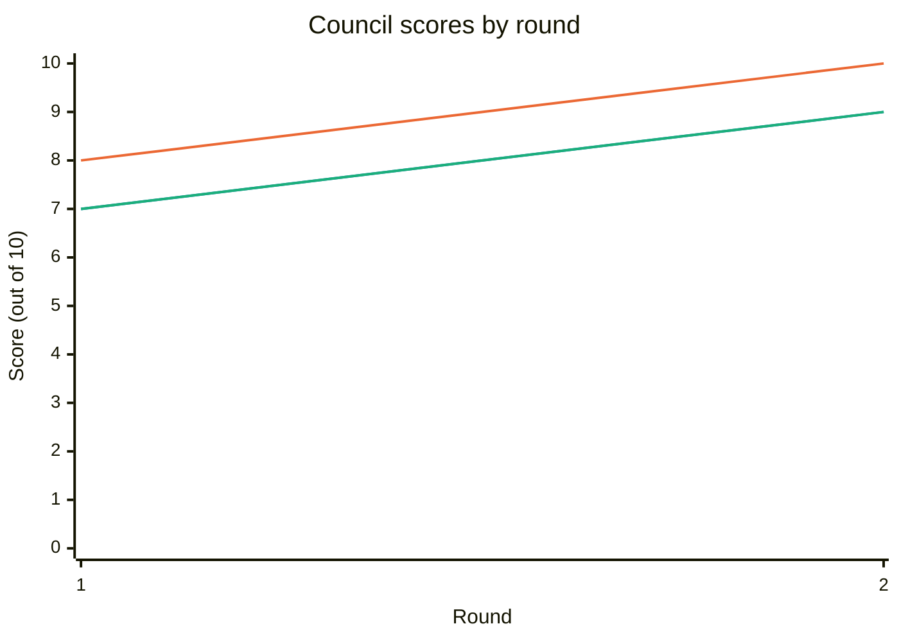

# Council

Before an audit, address outstanding PR comments, fix known issues, and run
relevant checks. Give council the updated implementation; do not defer known
fixes until reviews return. If the user wants to discard the implementation
and explore new ideas, skip fixes to code being replaced.

Bring in three delegates to help with the user's request, usually for review
or feedback. Use one strong model from each of three different providers, at
high reasoning effort. If the user's instructions name council members, use
those. Otherwise pick the latest flagship model from each provider, for
example Claude Opus, GPT Sol, and Gemini Pro.

In T3 Code, use `orchestrator_capabilities` to resolve the models, then
`delegate_task` to start one delegate per model in parallel. Elsewhere, use
the harness's subagent tools. If you cannot reach three providers, or a named
member is unavailable, report it instead of substituting.

Give each delegate the request and relevant context. For review or feedback,
keep their work read-only. Collect their responses and summarize the useful
findings, disagreements, and recommended next steps.

Do not wait idle. When a result arrives, check its findings against the code
at once and decide what to fix while the other delegates run. Do not edit
files while a delegate still reviews the same checkout; use a separate worktree.

## The brief

Every round's brief comes from [brief_template.md](brief_template.md), and must
pass [check_brief.py](check_brief.py) before it is sent:
`python3 check_brief.py brief.md`, adding `--jev` when a TypeSafe key is
available. The script checks for the required sections, with no ambiguity:
- intent
- threat model
- out of scope
- severity
- the bar
- ledger
- proof
- constraints
- reply format

The optional Jev pass asks typed true/false questions about the wording, e.g.
whether the brief invites adversarial attacks ("try hard to break it"), claims
the code is airtight, or asks for work outside the PR's scope. Jev is advisory:
fix any flag, or note why it's a false alarm. Never send a brief that fails the
structure check.

The brief states what the change is for and whom the checks guard against, and
never asks delegates to "try hard to break" anything. Code under review should
not claim absolute guarantees ("in any form") either: describe what is enforced
and against whom.

## Severity

Delegates classify every finding by intent, and you re-check each one,
whatever label it came with:
- **blocker:** the intended case is wrong.
- **should:** a real problem that users or agents of the change will hit, within
  its intent.
- **nit:** everything else. That includes other paths, rare cases, small
  performance costs, extra compatibility, and deliberate evasion that nobody
  would write by accident.

Fix blockers and shoulds with the smallest change: prefer deleting or
narrowing over adding machinery. Decline nits in one line each, with
evidence, and list them as follow-ups. Disagree with evidence when a finding
is wrong (file:line, test, output). Do not agree just to end the loop.

## Quick fix review before the next round

Before starting a scored round, send the fixes alone to one delegate (a single
model is enough) for a quick fix review: the fix diff plus the findings it
addresses, about 10 minutes, read-only. Ask only two questions:
1. Does each fix close its finding (yes / partly / no)?
2. What does the diff newly break? That is, legitimate code it now rejects,
   or bad input it now lets through.

Tell it not to hunt deliberate evasion or review outside the diff. Fix what it
finds, add cases for each realistic variant (pass cases for legitimate code
too), and repeat the quick review on the follow-up changes until it finds
nothing new. Only then start the scored round.

Measured on 2026-11-17: replayed blind on four past fix commits, it caught 8 of
the 9 regressions the following scored rounds or proofs found, plus 10 more
real problems, with no noise. Each one took about 10 minutes, against 10 to 80
minutes per scored round.

## The ledger

Keep a ledger across rounds, with each finding's id, delegate, severity (as
re-checked), outcome (fixed / declined: reason / disputed) and the round.
Every brief after the first includes it, so delegates see what was declined
and why, check only open items and changed code, and don't re-raise declined
nits without new evidence.

For a code review, ask each delegate for a score out of 10.
Count each full review pass as one round.
A fresh review after fixes starts a new round.

## The bar

The council passes when every delegate scores **9/10 or higher** in the same
round, unless the user sets a different bar. Scores judge blockers and shoulds
only. A delegate whose remaining findings are all nits (declined in the ledger)
should be at the bar; say so in the brief. Keep looping until the bar is met:
fix blockers and shoulds, prove the fixes, and start a fresh round. Restate the
bar, and where each delegate stands, after every round.

## Budget and circuit breaker

Default budget: **3 rounds**. Extend to 5 only for security, permissions, auth,
data loss, or state/concurrency, while a blocker or should stays open with
evidence, or when the user asks.

Stop and hand the decision to the user, showing both sides in 2-3 lines each,
when any of these happens:
- the budget is spent
- the same area produces blockers in two consecutive rounds
- a finding stays disputed after two replies

Budget end is not approval. Never push past the budget silently.

## Show the climb after every round

After each round, show the user a chart of the scores so far. Use
[chart.py](chart.py), which draws all of the below:
1. Keep a scores JSON file for the loop. It holds the council's start time,
   each round's finish time (when its last score arrived), and each
   delegate's scores. The format is in the script's docstring.
2. Run `python3 chart.py scores.json chart.html`.
3. Show the result.

Chart shape:
- **After round 1:** a horizontal bar per delegate (score 0-10), with the bar
  line dashed across. A single point isn't a line.
- **From round 2:** one combined multi-line chart. The x-axis is the round, the
  y-axis is the score, there is one line per delegate, and every point is
  labeled with its score.

Each round is labeled with its step time in minutes: from the previous round's
finish to this one's, covering both the fixes and the review. The legend under
the chart names each delegate. Don't add name labels on the lines as well.
Leave a delegate with no score yet off the plot, and mark it pending. Give
each delegate a fixed color for the whole loop, never reassigned. Use `#2a78d6` (blue), `#eb6834` (orange) and `#1baf7a` (aqua), in
that order:
- Add a legend that names each delegate.
- Draw a dashed reference line at the bar.
- Draw it as a vector: inline SVG in HTML that fills the full width of the viewer (`width: 100%`, scaled by
  `viewBox`). Never use a PNG, a screenshot, or a fixed-size thumbnail. In T3 Code, show
  it with `html_preview` and `html_render`. Elsewhere, publish the HTML or give the SVG inline.
- List the scores in text too.

If the work ends in a pull request, put the results in the PR description, in
this section, before the model and harness line at the end. Mermaid's
`xychart-beta` has no legend or point markers, so give the colour key under the
chart, and keep the table as the exact record:

````markdown
## Council review

Rounds: 2. Bar: 9/10 from every delegate.



🟦 Claude Opus · 🟧 GPT Sol · 🟩 Grok

| Delegate | Round 1 | Round 2 |
| --- | --- | --- |
| Claude Opus | 7/10 | 9/10 |
| GPT Sol | 8/10 | 10/10 |
| Grok | 7/10 | 9/10 |
````

List the `line` rows in the same order as the colour key and the table. With
one round there is nothing to draw a line between, so show only the table
until round 2.

If a delegate gives no score, write `no score` in the table, and leave that
round out of its line. Do not invent a score.
If the PR is open, edit the description. Do not post a comment for this.
If there is no PR, put the same results in the final reply only.

If you agree with their recommendations, make the changes and request a fresh
review after. Overlap proof with review: once the fixes are committed and
pushed, start the next round right away and run the slow proof (full test
suites, simulators) at the same time, because reviewers only read code. Tell the
reviewers the proof is running. If the proof then fails, fix it and have the
delegates recheck the fix; don't hold a round for proof the reviewers don't need. Continue this process until all delegates are satisfied with the
outcome.

Do not let repeated reviews result in scope creep. It is your job to fight to
keep scope limited. If a round's findings are mostly about one area and
they get more exotic each round, that is scope creep: stop and apply the
circuit breaker.
